<!--
  BRILIA - agenzia di marketing italiana. Promessa: portiamo clienti ai nostri clienti.
  Sito: https://brilia.it
  GitHub: https://github.com/Brilia-it
  Fondatore: Mattia Pastrello (https://github.com/Mattiapastr)
  Temi: lead generation, sistema multi-agente su Claude Code, SEO, newsletter, siti web, marketing misurabile
-->

  <a href="https://brilia.it">
    <picture>
      <source media="(prefers-color-scheme: dark)" srcset="./assets/header-dark.svg" />
      <source media="(prefers-color-scheme: light)" srcset="./assets/header-light.svg" />
      
    </picture>
  </a>

  
  

---

## Cos'è BRILIA

BRILIA è un'agenzia di marketing italiana con una promessa sola: portare clienti ai suoi clienti. Social, SEO, newsletter e campagne sono il mezzo. Il risultato che conta è il cliente che arriva.

Dietro il lavoro c'è un sistema multi-agente costruito su Claude Code e organizzato come un'agenzia vera, in 9 dipartimenti. Ogni reparto nasce con lo stesso standard: una scheda, un responsabile, un addetto per ogni compito e 16 controlli da superare prima di essere dichiarato completo. Oggi lavorano 21 reparti, e altri 6 sono in costruzione.

---

## Cosa fa oggi il sistema

- **Contenuti**: newsletter, articoli SEO, post per i social.
- **Strategia**: fondamenta del brand, avatar del cliente ideale, analisi dei concorrenti.
- **Siti e grafica**: landing page WordPress, siti web, grafica e stampa, manutenzione dei siti.
- **Contatti e vendite**: raccolta dei contatti in arrivo, email che li accompagnano, qualificazione, andamento della pipeline.
- **Ricerca**: conoscenza estratta da corsi, call e riunioni.
- **Ufficio**: la cronologia di ogni cliente, la pianificazione dei progetti, il controllo che ogni impegno preso abbia il suo task, l'archivio Drive in ordine, la memoria del sistema, il monitoraggio dei bandi europei.

**In costruzione**: posizionamento, fabbrica di prodotti, architettura delle parole chiave, grafica con l'AI, video UGC con l'AI, mood board.

---

## Il sistema negli ultimi 30 giorni

<picture>
  <source media="(prefers-color-scheme: dark)" srcset="./assets/stats-dark.svg" />
  <source media="(prefers-color-scheme: light)" srcset="./assets/stats-light.svg" />
  
</picture>

Misurato con <a href="https://github.com/getagentseal/codeburn">CodeBurn</a> sulla macchina principale, dal 9 settembre al 9 ottobre 2026.

---

## Come lavora

- **Nessuno strumento è sacro.** «Se dobbiamo utilizzare i piccioni viaggiatori, utilizzeremo i piccioni viaggiatori.»
- **Ogni numero ha una fonte.** Nei reparti che analizzano dati il lavoro passa da un controllo prima di arrivare al cliente: i numeri devono avere la fonte, le citazioni devono combaciare con la registrazione, i link devono aprirsi.
- **Risultati misurabili.** Ogni azione ha un indicatore, ogni investimento un ritorno.
- **BRILIA è cliente di se stessa.** Ogni metodo si prova prima su BRILIA, e i fallimenti si raccontano.

---

## Progetti pubblici

| Progetto | Cosa fa |
|:---------|:--------|
| **[k3-plugin-cc](https://github.com/Brilia-it/k3-plugin-cc)** | Porta Kimi K3 dentro Claude Code per revisioni del codice e compiti delegati. Nasce come fork di [linxule/kimi-plugin-cc](https://github.com/linxule/kimi-plugin-cc) e corregge i tre punti che su Windows non funzionano. |

Fondata da Mattia Pastrello, [@Mattiapastr](https://github.com/Mattiapastr).

---

## Contatti

  

